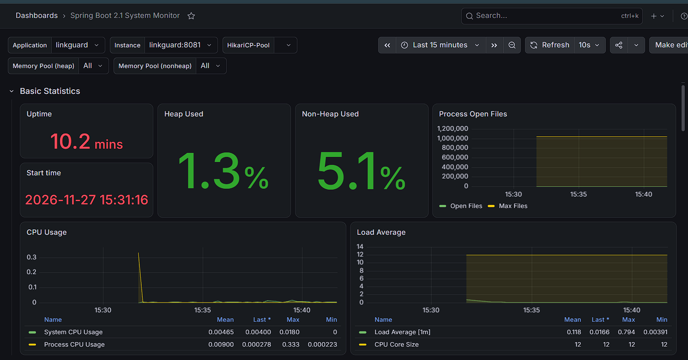

# LinkGuard

[](https://github.com/AymenSaleh/linkguard/actions/workflows/ci.yml)
[](https://sonarcloud.io/summary/new_code?id=AymenSaleh_linkguard)
[](https://sonarcloud.io/summary/new_code?id=AymenSaleh_linkguard)
[](https://sonarcloud.io/summary/new_code?id=AymenSaleh_linkguard)

Application web Spring Boot qui analyse un lien et estime son risque de phishing (`FAIBLE`, `MOYEN`, `ELEVE`), livrée avec un pipeline DevSecOps sur GitHub Actions.

Mini-projet DevSecOps — EPI Sousse, 2026-2027.

## Règles d'analyse

| Signal | Points |
|---|---|
| Adresse IP à la place d'un nom de domaine | +3 |
| Symbole `@` dans le lien | +3 |
| Nom de domaine en punycode (`xn--`) | +2 |
| Plus de 3 points dans le nom d'hôte | +2 |
| Pas de HTTPS | +1 |
| Lien de plus de 75 caractères | +1 |
| Mots suspects (`login`, `verify`, `account`…) | +1 |

Score ≥ 5 : `ELEVE` · score ≥ 3 : `MOYEN` · sinon : `FAIBLE`.
Seuls les liens `http` et `https` sont acceptés ; tout autre lien reçoit une réponse HTTP 400.

## Lancer en local

```powershell
.\mvnw.cmd clean verify
java -jar target\linkguard-0.0.1-SNAPSHOT.jar
```

`verify` exécute aussi les tests et produit le rapport de couverture JaCoCo : `target\site\jacoco\index.html`.

Interface : http://localhost:8080 · API : `GET /api/analyze?url=<lien>` · Mesures (port de gestion) : http://localhost:8081/actuator/prometheus

## Docker

```powershell
docker build -t linkguard:local .
docker run -d -p 8080:8080 linkguard:local
```

Image durcie : JRE 21 sur Alpine (pas de JDK), correctifs de l'OS appliqués au build (`apk upgrade`), exécution sans root (utilisateur `linkguard`, uid 100).

## Pipeline CI/CD (`.github/workflows/ci.yml`)

Déclenché par un push sur `main` ou sur une branche `feature/**`, et par une pull request vers `main`.

| Étape | Outil | Fait échouer le pipeline si… | Rapport |
|---|---|---|---|
| 1. Secrets dans les commits | Gitleaks | un secret est détecté | artefact `gitleaks-report` (SARIF) |
| 2. Compilation, tests, couverture | Maven + JaCoCo | un test échoue | `target/site/jacoco` |
| 3. Analyse statique (SAST) | SonarQube Cloud | le Quality Gate échoue (sur les PR et sur `main`) | tableau de bord SonarQube Cloud et commentaire sur la PR |
| 4. Construction de l'image | Docker | la construction échoue | — |
| 5. Scan de l'image | Trivy | une vulnérabilité MEDIUM ou plus, corrigeable, est trouvée | artefact `trivy-report` (toutes sévérités) |
| 6. Test du conteneur | curl | l'application ne répond pas | — |
| 7. Publication (sur `main` uniquement) | Docker Hub | — | `aymensaleh/linkguard`, tags `<sha du commit>` et `latest` |

Secrets GitHub utilisés (aucune valeur dans le code) : `DOCKERHUB_USERNAME`, `DOCKERHUB_TOKEN`, `SONAR_TOKEN`, `SONAR_ORGANIZATION`, `SONAR_PROJECT_KEY`.

## Résultats (27 novembre 2026)

- **Gitleaks** : aucune fuite. Un faux secret de test a fait échouer le pipeline, puis l'historique a été réécrit.
- **Trivy** : 0 vulnérabilité MEDIUM ou plus corrigeable après durcissement de l'image (76 avant). Image compressée : de 216,96 Mo à 91,13 Mo.
- **SonarQube Cloud** (`main`) : Quality Gate **Passed** · Security **A** · Reliability **A** · Maintainability **A** · couverture **94,4 %** · duplication **0,0 %**.

## Répétition des échecs (27 novembre 2026)

Chaque outil a été mis en échec volontairement sur une branche de répétition jamais fusionnée, puis le problème a été retiré (pour le faux secret : réécriture de l'historique de la branche).

| Changement introduit | Ce qui l'arrête | Ce qu'on observe |
|---|---|---|
| Action non épinglée : `actions/checkout@v6` | Politique du dépôt, avant toute étape (« Set up job ») | « The action actions/checkout@v6 is not allowed in AymenSaleh/linkguard because all actions must be pinned to a full-length commit SHA » ; aucune étape exécutée |
| Faux token GitHub (`ghp_…`) dans un fichier | Gitleaks | règle `github-pat`, fichier et ligne indiqués, secret masqué (`REDACTED`) ; GitHub n'a pas refusé le push ; rien n'est construit ni publié |
| Bibliothèque vulnérable : `commons-text 1.9` | Politique Trivy | CVE-2022-42889 (Text4Shell), CRITICAL, corrigée en 1.10.0 ; l'image n'est pas publiée |
| Chiffrement faible (DES) dans le code Java, sur une PR | Quality Gate SonarQube Cloud | « D Security Rating on New Code » ; deux checks obligatoires en échec, fusion impossible. Après passage à AES/GCM : Quality Gate passed |

Le rapport Trivy complet de l'image actuelle (toutes sévérités, failles sans correctif comprises) est vide : changer la sévérité ou retirer `ignore-unfixed` ne fait pas échouer le pipeline. Seul un composant vulnérable le fait.

## Touche personnelle : chaîne d'approvisionnement et gouvernance

Point de départ : sur la PR #6, SonarQube Cloud a fait échouer le Quality Gate (Security C) à cause de deux actions tierces référencées par un tag (`gitleaks-action@v3`, `login-action@v4`). Un tag peut être déplacé vers du code malveillant, comme ce fut le cas pour `trivy-action` en mars 2026 (CVE-2026-33634). Et la PR rouge restait fusionnable.

1. **Toutes les actions sont épinglées par SHA complet**, avec la version en commentaire, y compris celles de GitHub. Les SHA ont été vérifiés sur les dépôts officiels, et les actions composites (`trivy-action`, puis `setup-trivy`) épinglent elles aussi leurs dépendances.
2. **Politique du dépôt** « Require actions to be pinned to a full-length commit SHA » : toute action non épinglée fait échouer le workflow avant son démarrage.
3. **Ruleset `protect-main`** sur `main` : pull request obligatoire ; checks obligatoires `build-test-push` (source : GitHub Actions) et `SonarCloud Code Analysis` (source : SonarQube Cloud) ; historique linéaire (rebase uniquement) ; ni force push ni suppression. Vérifié : un push direct sur `main` est refusé (`GH013`).

Autres choix de sécurité : token SonarQube Cloud passé par variable d'environnement (règle Sonar S7636) et doté d'une date d'expiration ; version du scanner SonarQube figée dans `pom.xml` ; analyse automatique de SonarQube Cloud désactivée au profit de l'analyse dans le pipeline (couverture et Quality Gate bloquant).

## Supervision (bonus TP4) : Prometheus et Grafana

L'application publie ses mesures avec Spring Boot Actuator et Micrometer ; Prometheus les collecte toutes les 15 s et Grafana les affiche.

```text
LinkGuard (:8081/actuator/prometheus)  →  Prometheus (:9090)  →  Grafana (:3001, tableau de bord 11378)
```

```powershell
docker compose -f monitoring/docker-compose.yml up -d
```

- **Grafana** : http://127.0.0.1:3001. Premier accès `admin` / `admin`, puis Grafana demande un nouveau mot de passe (ne pas cliquer sur « Skip »). Importer le tableau de bord **11378** (*Spring Boot 2.1 System Monitor*) ; la source de données Prometheus est déjà déclarée en code.
- **Prometheus** : http://127.0.0.1:9090 (cible `linkguard`).
- **Arrêt** : `docker compose -f monitoring/docker-compose.yml down` (avec `-v`, les données de Grafana sont aussi effacées).

| Point | Dans le TP | Ici |
|---|---|---|
| Endpoints Actuator exposés | tous (`include=*`), dont `env` et `heapdump` | `health` et `prometheus` seulement |
| Port des endpoints | celui de l'application (8080) | port de gestion séparé (8081), jamais publié : seul Prometheus l'atteint, dans le réseau Docker |
| Application supervisée | lancée sur la machine (`mvn spring-boot:run`) | image publiée par le pipeline, épinglée par le SHA de son commit |
| Images Prometheus et Grafana | sans tag (`latest`) | versions figées : Prometheus `v3.13.5` (LTS), Grafana `13.3.2` |
| Ports publiés | sur toutes les interfaces | sur `127.0.0.1` uniquement (Prometheus n'a pas d'authentification par défaut) |
| Mot de passe Grafana | `admin`, écrit dans le compose | aucun mot de passe dans le dépôt ; changement demandé à la première connexion |
| Source de données Grafana | ajoutée à la main | déclarée en code (provisioning), non modifiable depuis l'interface |
| Fichiers de configuration | montés en écriture | montés en lecture seule |
| Démarrage | — | healthcheck Docker sur `/actuator/health` : Prometheus attend que l'application soit prête |

Vérifications du 27 novembre 2026 :
- **en local** : `/actuator/prometheus` répond sur 8081 et renvoie 404 sur 8080 ; `/actuator/env` et `/actuator/heapdump` renvoient 404 ;
- **avec Docker Compose** : la cible Prometheus est `up` (`up=1`, label `application=linkguard`) ; depuis la machine, 8081 ne répond pas, alors que 8080 et Grafana répondent ;
- **Grafana** : le tableau de bord 11378 affiche la mémoire, le CPU et l'uptime de l'application.



## Workflow Git

Une branche `feature/...` par fonctionnalité, une pull request vers `main`, puis « Rebase and merge » (seule méthode autorisée).
Messages de commit typés : `feat:`, `fix:`, `test:`, `chore:`, `docs:`.
